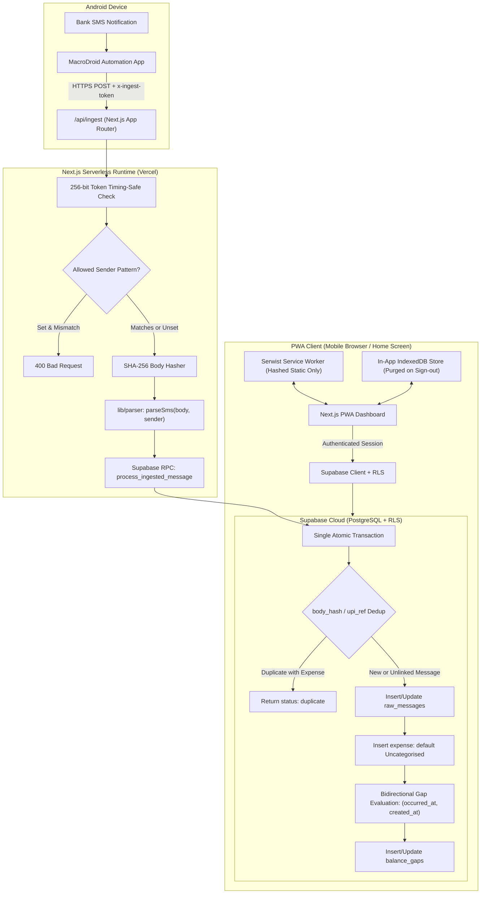
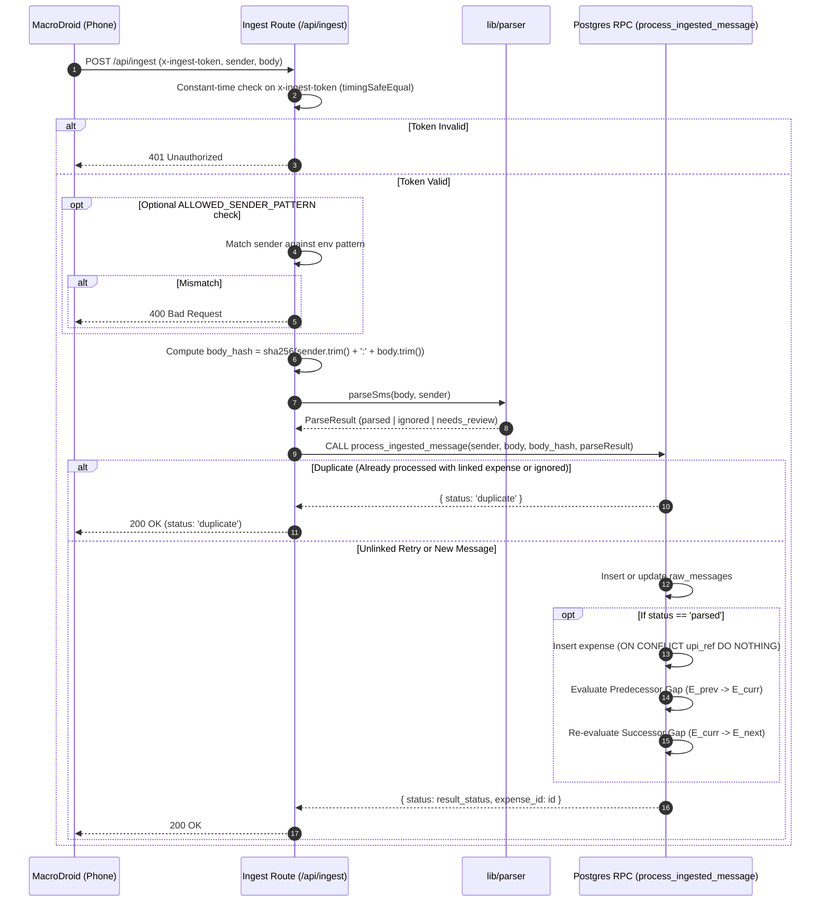
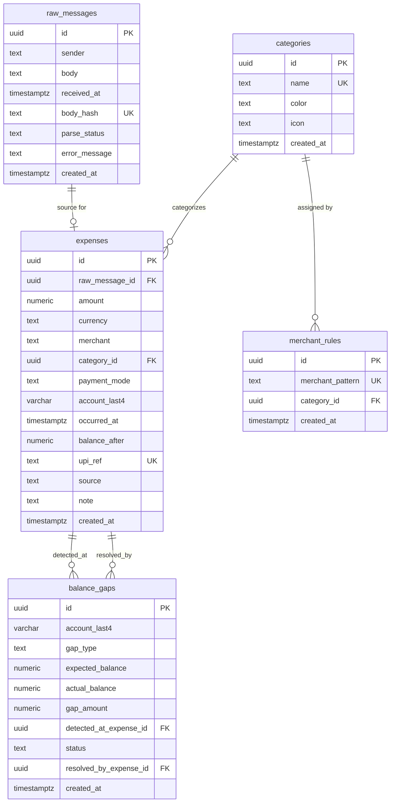

# Architecture & Technical Design (docs/ARCHITECTURE.md)

> **Document Status**: Approved Technical Design  
> **Source of Truth Reference**: [`docs/PROMPT.md`](file:///d:/ET_V1/docs/PROMPT.md)  
> **Specification Reference**: [`docs/SPEC.md`](file:///d:/ET_V1/docs/SPEC.md)

---

## 1. System Overview & Architecture

The system provides automated personal expense tracking for a single user by capturing SMS debit notifications on an Android smartphone and syncing them to a private Progressive Web App via a secured, atomic ingestion pipeline.



---

## 2. Ingestion Pipeline & Atomic Deduplication State Machine

All writes (`raw_messages`, `expenses`, and `balance_gaps`) execute inside a single PostgreSQL function (`process_ingested_message`) so crashes never strand messages.



---

## 3. Database Schema & Entity Relationships



---

## 4. Parser Architecture (`lib/parser`)

### 4.1 Strict Function Signature & Types
The parser interface is strictly defined as:

```typescript
export interface ParsedExpense {
  amount: number; // Stored as numeric(12,2), handled in integer paise in calculations
  merchant: string;
  paymentMode: 'UPI' | 'card' | 'netbanking' | 'atm' | 'other';
  accountLast4: string;
  occurredAt: Date;
  upiRef: string | null;
  balanceAfter: number | null;
}

export type ParseResult =
  | { status: 'parsed'; data: ParsedExpense }
  | { status: 'ignored'; reason: 'otp' | 'credit' | 'promo' | 'balance_alert' }
  | { status: 'needs_review'; reason: 'unrecognized_format' | 'low_confidence' };

export function parseSms(body: string, sender: string): ParseResult;
```

---

## 5. Bidirectional Balance Gap Engine & Precision Arithmetic

### 5.1 Deterministic Ordering & Out-of-Order Healing
Transactions within the same account are ordered by:
$$(\text{occurred\_at ASC}, \text{created\_at ASC})$$

When transaction $E_{\text{curr}}$ is inserted:
1. **Predecessor Check ($E_{\text{prev}} \to E_{\text{curr}}$)**:
   - Identify $E_{\text{prev}}$: greatest `(occurred_at, created_at)` strictly before $E_{\text{curr}}$ with non-null balance on `account_last4`.
   - Calculate in integer paise:
     $$\Delta_{\text{prev}} = E_{\text{curr}}.\text{balance\_after} - (E_{\text{prev}}.\text{balance\_after} - E_{\text{curr}}.\text{amount})$$
   - If $\Delta_{\text{prev}} < 0$: Create/update `under_balance` gap (active *"possible missed transaction"* notice).
   - If $\Delta_{\text{prev}} > 0$: Create/update `over_balance` gap (quiet note: *"balance higher than expected, likely a credit"*).
2. **Successor Check ($E_{\text{curr}} \to E_{\text{next}}$)**:
   - Identify $E_{\text{next}}$: lowest `(occurred_at, created_at)` strictly after $E_{\text{curr}}$ with non-null balance on `account_last4`.
   - Recompute expected balance for $E_{\text{next}}$ based on $E_{\text{curr}}.\text{balance\_after}$.
   - Realignment updates or clears any previous gap notice on $E_{\text{next}}$.
3. **Auto-Resolution**:
   - Manually entering an expense matching an unresolved `under_balance` gap within the time window sets `status = 'resolved'`. Manual dismissal is always available.

---

## 6. Rate Limiting Architecture & Recommendation

- **Vercel Serverless Reality**: In-memory rate limiting is ineffective because Vercel requests hit distinct ephemeral serverless container instances.
- **Option A (Recommended)**: Use the **256-bit cryptographically random token** (`INGEST_SECRET_TOKEN`, 32 bytes hex) evaluated in constant time as the primary gatekeeper. With $2^{256}$ entropy, brute-forcing is mathematically infeasible.
- **Option B**: Introduce Upstash Redis (`@upstash/ratelimit`). This requires an external managed Redis cluster, additional credentials (`UPSTASH_REDIS_REST_URL`, `UPSTASH_REDIS_REST_TOKEN`), and network latency overhead.
- **Design Decision**: Option A is recommended for lean, zero-dependency deployment of a single-user private webhook.

---

## 7. Service Worker & Offline Data Security

1. **Service Worker (Serwist)**:
   - **Cache-First**: Applied exclusively to hashed static assets (`/_next/static/*`, static PNG/SVG icons, fonts).
   - **Network-First**: Applied to document pages and dynamic routes.
   - **Strict Zero-Cache Rule**: Under no circumstances may `/api/*`, Supabase REST endpoints, or authentication cookies be cached in the Service Worker Cache API.
2. **In-App Offline Store (IndexedDB / React Query)**:
   - Dashboard summaries and recent transactions are cached in-memory/IndexedDB strictly within the application sandbox.
   - **Purge on Sign-Out**: Calling `signOut()` immediately invokes a storage cleanup routine that flushes all cached transaction records from IndexedDB.

---

## 8. Row-Level Security (RLS) & Phase 1 Verification

### 8.1 Single-Owner RLS Policy Pattern
Once the owner user is created in Supabase Auth, all tables enforce:
```sql
CREATE POLICY "Owner access only" ON public.expenses
    FOR ALL TO authenticated
    USING (auth.uid() = '<OWNER_UID>')
    WITH CHECK (auth.uid() = '<OWNER_UID>');
```

### 8.2 Anon Key REST Verification Test
```bash
curl -i "https://<project-ref>.supabase.co/rest/v1/expenses" \
  -H "apikey: <NEXT_PUBLIC_SUPABASE_ANON_KEY>"
```
- Must return `[]` or `401 Unauthorized`. Verifies that no financial records are exposed to public unauthenticated requests.
